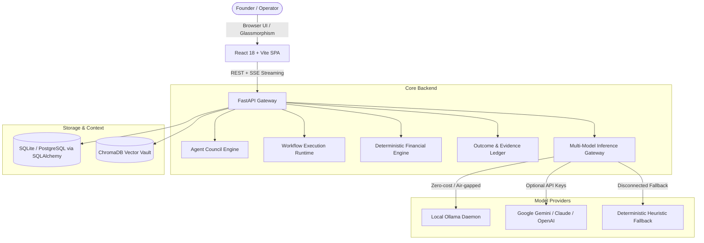

# OneBoard: AI Operating System for a Company of One

> **"Run a company of one with the capabilities of a team."**

[](#)
[](LICENSE)
[](https://python.org)
[](https://fastapi.tiangolo.com)
[](https://vitejs.dev)
[](https://ollama.com)

---

## Executive Summary

Solopreneurs, boutique agency owners, and technical consultants operate at a structural disadvantage: they are forced to juggle strategy, cash flow, marketing, client delivery, operations, and compliance simultaneously. Conventional tools offer either generic chat windows (which hallucinate business math and forget context) or static automation tools (which lack contextual judgment).

**OneBoard** bridges this gap. It is an **autonomous, auditable AI Operating System** that equips a solo founder with an executive board of specialized AI advisers, a deterministic financial engine, an automated workflow execution runtime with Human-in-the-Loop approval gates, and a verifiable accountability ledger.

---

## Core Pillars & Architectural Innovations

### 1. Multi-Agent Autonomous Boardroom (Council Deliberation)
- **7 Autonomous Domain Advisers**:
  - **Chief of Staff / Strategy**: Executive synthesis, cross-department orchestration, priority setting.
  - **CFO / Finance**: Runway calculations, cash flow preservation, unit economics, pricing models.
  - **CMO / Marketing**: Customer acquisition, outbound funnels, positioning, copy review.
  - **COO / Operations**: Delivery bottlenecks, capacity planning, process automation.
  - **CPO / Product**: Roadmaps, user feedback loop, feature prioritization.
  - **General Counsel / Compliance**: Contract risks, regulatory posture, liability exposure.
  - **CTO / Technology**: Architecture resilience, technical debt, security safeguards.
- **Structured Deliberation Protocol**:
  1. *Context Assembly*: Ingests live financial numbers, active goals, and verified evidence.
  2. *Independent Analysis*: Each adviser evaluates the proposal through their domain lens.
  3. *Adversarial Challenge Round*: Advisers cross-examine peer recommendations (e.g., CFO challenges CMO's CAC projections).
  4. *Executive Synthesis*: Highlights points of consensus, explicit trade-offs, and residual risks.
  5. *Founder Sovereign Decision*: Final authority remains strictly with the founder (Approve, Modify, Reject).

### 2. Evidence-Based Accountability & Outcome Ledger
- **No Hallucinated Decisions**: Every council recommendation links to cryptographic hashes of underlying documents, invoices, or database records.
- **Empirical Variance Tracking**: Quantifiable forecasts (e.g., "Predicting 50 signups in 30 days") are tracked against verified real-world outcomes.
- **Dynamic Adviser Calibration**: Advisers accumulate predictive track records; inaccuracy adjusts adviser confidence weightings over time.

### 3. Deterministic Financial Core
- **Zero Hallucinated Arithmetic**: Financial calculations (MRR, burn rate, runway in months, CAC/LTV, active paying clients, gross margins) are executed via pure deterministic Python functions, not LLM token generation.
- **Live Runway Warnings**: Triggers automatic contingency plans if cash runway drops below critical thresholds.

### 4. Visual Workflow Studio & Execution Runtime
- **Directed Acyclic Graph (DAG) Engine**: Visual node-based workflow builder with automated cycle detection and topological sorting.
- **Human-in-the-Loop (HITL) Gates**: Sensitive actions (e.g., invoices over $500, bulk client emails, outbound contract commitments) require explicit founder sign-off before proceeding.
- **Deterministic Tool Calling**: Secure tool registry strictly isolated from system shell or destructive commands.

### 5. Multi-Model Inference Gateway (Ollama Local + Cloud Fallback)
- **Local Privacy-First Processing**: Built for complete offline/air-gapped local execution via Ollama (`qwen2.5`, `llama3.2`, `phi3.5`, `deepseek-r1`).
- **Zero-Token Offline Simulation Engine**: When offline or if Ollama is disconnected, OneBoard's deterministic heuristic engine ensures all workflows, boardroom sessions, and analyses run seamlessly without disruption.
- **Task-Based Dynamic Routing**: Automatically assigns lighter models to fast classification and larger models to complex strategic synthesis.

---

## System Architecture



---

## Turnkey Demo Data: "NorthStar Studio"

OneBoard ships with a turnkey, realistic creative & software agency pre-seeded into the database:
- **Business Profile**: NorthStar Studio (Solo Founder: Alex Mercer)
- **Cash Balance**: $132,840.00
- **Monthly Recurring Revenue (MRR)**: $18,500.00
- **Burn Rate**: $7,200.00/month (18.4 months runway)
- **Active Paying Clients**: 28 accounts
- **Pre-populated Artifacts**:
  - Live executive council meetings with complete deliberation transcripts and challenge rounds.
  - 10+ verified evidence records (Stripe exports, client contracts, pipeline metrics).
  - Production workflows (e.g., "Lead Qualification & Onboarding Pipeline" with approval gates).

---

## Quickstart & Local Setup

### Prerequisites
- **Python 3.11+**
- **Node.js 18+** & `npm`
- *(Optional)* [Ollama](https://ollama.com) installed and running locally

### 1. Clone & Set Up Backend

```bash
# Clone the repository
git clone https://github.com/your-username/oneboard.git
cd oneboard

# Create and activate virtual environment
python -m venv .venv
# On Windows:
.venv\Scripts\activate
# On Linux/macOS:
source .venv/bin/activate

# Install dependencies
pip install -r apps/api/requirements.txt
```

### 2. Configure Environment

Create a `.env` file in `apps/api/`:
```env
APP_NAME=OneBoard
ENVIRONMENT=development
DATABASE_URL=sqlite:///./data/oneboard.db
OLLAMA_BASE_URL=http://localhost:11434
# Optional cloud provider keys (fallback only):
# GEMINI_API_KEY=your_key_here
# OPENAI_API_KEY=your_key_here
# ANTHROPIC_API_KEY=your_key_here
```

### 3. Initialize Database & Seed Demo Data

```bash
python scripts/seed_database.py
```

### 4. Start the Application

**Option A — Automated One-Click Script (Windows)**:
```powershell
.\scripts\run_all.ps1
```

**Option B — Manual Start**:
```bash
# Terminal 1: Backend API
cd apps/api
uvicorn main:app --reload --port 8000

# Terminal 2: Frontend Web App
cd apps/web
npm install
npm run dev
```

The frontend will be live at `http://localhost:5173` and the backend Swagger documentation at `http://localhost:8000/docs`.

---

## Test Suite & Verification

OneBoard includes comprehensive unit, integration, and adversarial tests:

```bash
# Run all unit tests
pytest tests/unit -v

# Run multi-agent integration tests
pytest tests/integration -v

# Run adversarial prompt injection & traversal security tests
pytest tests/adversarial -v

# Run full Ollama integration test suite
pytest tests/test_ollama_integration.py -v
```

---

## Security & Privacy Commitment

1. **Local-First Air-Gapping**: Sensitive business financials and customer PII stay entirely on your local workstation when using local Ollama models.
2. **Deterministic Sandboxing**: Workflows execute in memory with strictly typed tool adapters. No dynamic `eval()`, shell execution, or unauthorized file-system modifications.
3. **Audit Trail**: Every adviser suggestion, challenge, founder override, and action execution is permanently written to an immutable audit ledger.

---

## Competition Submission Details

- **Event**: Dubai AI Agents Championship
- **Category**: AI Agents for Business Operations & Solo Founders
- **Creator**: Mihika Singh
- **Contact**: [GitHub Issues / Discussion](https://github.com/your-username/oneboard)
