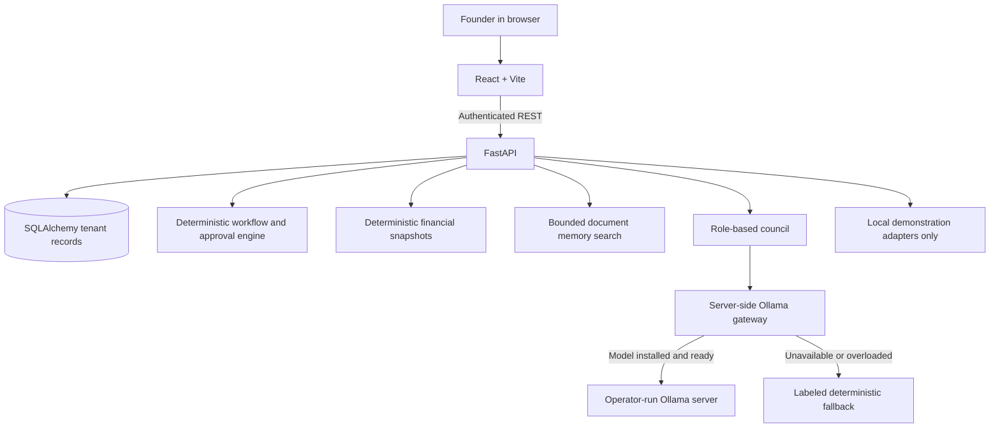

# OneBoard: AI Operating System for a Company of One

> Run a company of one with the capabilities of a team.

[](#)
[](https://fastapi.tiangolo.com/)
[](https://vite.dev/)
[](https://ollama.com/)

> **Release status, 25 November 2026: local-first engineering prototype, not a production-certified SaaS.** Do not deploy publicly or handle real customer data without completing the security, hosting eligibility, backup, privacy and external-operations gates documented in [TEST_REPORT.md](TEST_REPORT.md), [critical readiness controls](docs/CRITICAL_READINESS_CONTROLS.md) and [P1 acceptance limits](docs/P1_ENGINEERING_ACCEPTANCE.md). The current implementation uses authenticated, tenant-scoped application records, sandbox adapters and local/server-side Ollama when available. Offline responses are marked as deterministic fallbacks, **not** real AI inference. Provider routing and synchronization infrastructure are implemented. Cloud-model failover on an eligible external host and externally certified availability are not implemented or verified end to end; authorized live third-party synchronization remains unverified. See [Batch P release gates](docs/BATCH_P_RELEASE_ENGINEERING.md) for the acceptance policy. PostgreSQL job leases and scoped runtime roles are implemented and require operator provisioning.

## What OneBoard currently does

OneBoard gives a solo founder one place to view their own business records, deliberate with role-based AI advisers, build accountable workflows and review why an action or recommendation was produced.

### 1. Nine-role executive council

Nine defined adviser roles include Chief of Staff, Strategy, Finance, Operations, Marketing, Technology, Customer Success, Risk and Compliance, and Research. The council assembles tenant-scoped records, requests independent positions from an available Ollama model, compares specialist positions and shows founder decisions. When inference is offline, its output is explicitly labeled deterministic fallback. Council opinions, forecasts and conclusions are **not independently verified expert advice**.

### 2. Human-approved workflow execution

Workflow definitions are validated as directed acyclic graphs and executed in topological order. Approval checkpoints stop execution until the founder makes a decision. Rejected, stale or mismatched approvals cannot authorize downstream execution; dry-runs do not dispatch tools. Production requests require tenant-scoped idempotency keys, and interrupted executions can be quarantined without automatic replay of uncertain effects. The tool registry supports controlled reads, calculations and sandbox drafting. **Real external email delivery, bank transfers, contract commitments and other third-party side effects are not implemented.**

### 3. Deterministic, source-labeled financial snapshots

The financial engine calculates recorded active-customer MRR, normalized recurring expenses, net burn, estimated runway and overdue invoice amounts with explicit boundary handling. Unknown reporting periods, negative and nonfinite figures trigger a data-quality warning rather than a reassuring health result. The dashboard shows source-record IDs, currency, timestamps and the statement that balances are **user-recorded, not independently reconciled**. This is not a bank connection, an audited ledger, or GAAP/IFRS reporting. Verified CAC/LTV and gross-margin accounting are not advertised.

### 4. Tenant-owned business memory and integration sandbox

Business Memory ingests bounded local documents (TXT, Markdown, JSON, CSV, XLSX and PDF), stores tenant-owned chunks and supports bounded retrieval. PostgreSQL uses indexed lexical retrieval and genuine model embeddings with multiprobe angular LSH and bounded cosine reranking. Local fallback remains bounded; indexed candidate truncation is labeled. This **does not guarantee exhaustive recall** or cryptographic verification of source truth. The app uses SQLAlchemy-backed records rather than a deployed ChromaDB vector service.

The Integration screen distinguishes synthetic fixture refresh from live provider sync. The fixed Northstar CRM, finance and GitHub examples are only available in an explicitly enabled demo workspace, never to regular businesses or in production. Live provider OAuth and synchronization are unavailable. Sandbox emails are not externally delivered.

### 5. Server-side AI with honest failure states

The API can call an operator-run Ollama daemon. The selected workspace profile must have its exact model installed before the UI claims inference is ready. PostgreSQL shares two concurrent inference HTTP admission slots across API workers; SQLite uses process-local slots; overloaded, offline, missing-model, timeout, malformed and incomplete responses fall back to a clearly labeled deterministic notice. **No browser model download is required by the normal architecture.** Actual free, eligible, reliable server hosting has not been approved or deployed.

## Architecture



SQLite is for development and disposable local demos. Production multi-tenant mode requires a migrated PostgreSQL database and strict TLS, Host, trusted-proxy and cookie configuration. These guards are **not proof of a real deployment**.

## Quickstart for local development only

Prerequisites: Python 3.11+, Node.js 22.12+, npm, and optionally a local Ollama daemon. A local start does not use a hosted provider or require any paid service.

```bash
git clone https://github.com/mihika-3159/OneBoard.git
cd OneBoard
python -m venv .venv
# Linux/macOS: source .venv/bin/activate
# Windows PowerShell: .venv\\Scripts\\Activate.ps1
python -m pip install --require-hashes --only-binary=:all: -r apps/api/requirements.lock
```

Create a root `.env` for disposable **development** data:

```env
AUTH_SECRET_KEY=replace-with-a-long-random-development-only-value
ONEBOARD_DEMO_MODE=false
ONEBOARD_PRODUCTION_MODE=false
DATABASE_URL=sqlite:///./data/oneboard.db
OLLAMA_BASE_URL=http://127.0.0.1:11434
CORS_ORIGINS=http://localhost:5173,http://127.0.0.1:5173
```

Start the API and frontend in separate terminals:

```bash
python -m uvicorn apps.api.main:app --host 127.0.0.1 --port 8000
```

```bash
cd apps/web
npm ci
npm run dev
```

The local frontend runs at `http://localhost:5173` and the local API docs at `http://127.0.0.1:8000/docs`. Register a fresh synthetic workspace to test tenant isolation. Set `ONEBOARD_DEMO_MODE=true` only for an intentionally isolated demonstration with synthetic Northstar Studio data. **Do not seed or reset a real account**. Windows startup scripts have not yet received a separate clean-machine acceptance run.

## Verification

The repository runs GitHub Actions checks on draft PRs, including Python unit/adversarial/HTTP tests, frontend TypeScript build, PostgreSQL migration and concurrent security tests, a disposable database backup/restore drill, Chromium browser E2E and a small **real** Ollama CPU inference job. The separate browser inference experiment is not the recommended/default product architecture.

Local checks:

```bash
python -m compileall -q apps/api tests alembic
python -m pytest -v
cd apps/web && npm ci && npm run build
```

Browser tests: from `apps/web` run `npx playwright test` after installing Chromium, with the repository's disposable local API configuration. The PostgreSQL restore script explicitly refuses non-disposable databases. See [TEST_REPORT.md](TEST_REPORT.md) for exact verified commits, CI logs, skipped tests and unresolved cases.

## Security, privacy and deployment limits

- Business access and memberships are scoped by tenant; production requires strong authentication configuration, HTTPS Host validation, secure cookies, explicit trusted proxy IPs and PostgreSQL.
- Audits are database records, **not cryptographically immutable** or independently attested.
- Alerts can be reconstructed from persisted invoices and commitments after a restart; the APScheduler interval job and sandbox email outbox remain **process-local and are not a distributed durable queue**.
- An operator-approved deployment must separately prove TLS termination, offsite encrypted backups and restore retention, private networking, provider eligibility, usable server-side inference, monitoring and load behavior. No claim of 24/7 uptime is made.

## Project

Developed for the Dubai AI Agents Championship. Technical questions and reproducible issues can be raised in this repository. The project remains on a draft engineering pull request while production acceptance checks are incomplete.


## Restricted runtime and scheduled workflows

Use the hash-locked Python installation on supported Python 3.11 environments.
See [Batch E operator notes](docs/BATCH_E_ENGINEERING.md) for separate migration
and runtime database roles, daily/weekly IANA timezone schedules, retention
and bounded consistent export. Local CI evidence is not deployment approval.
